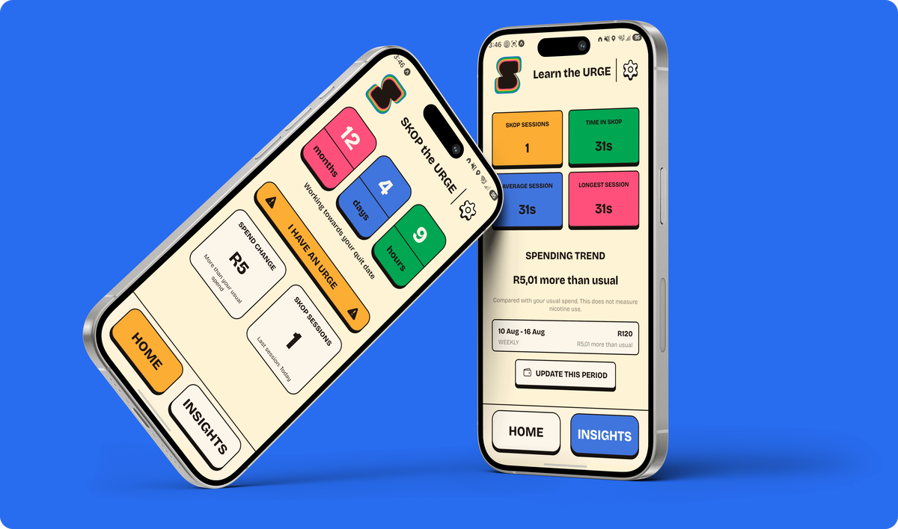
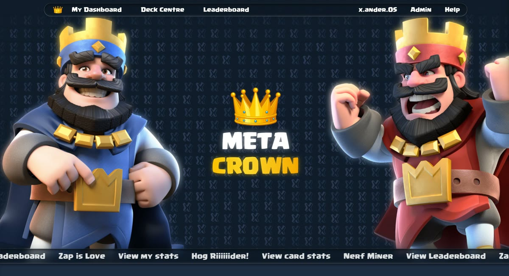
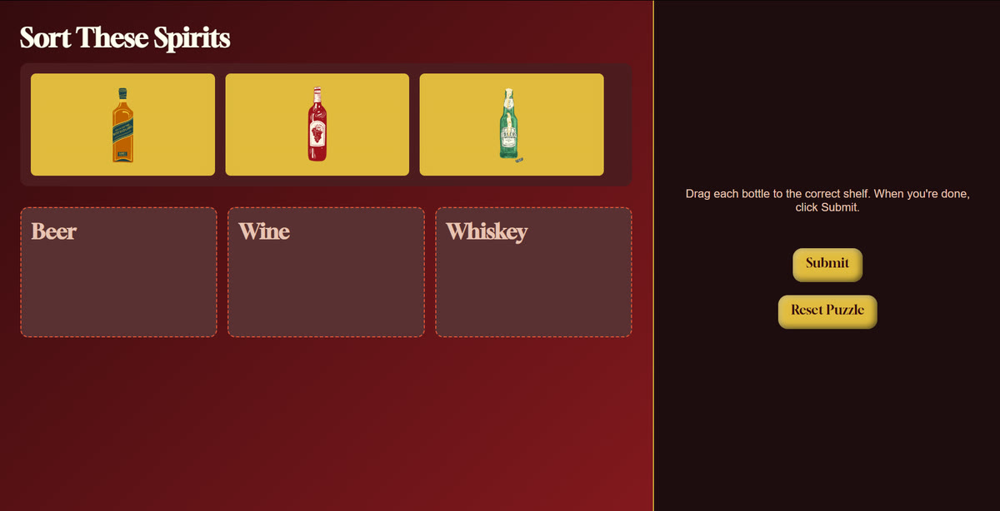

<h1 align="center">Xander Poalses</h1>

<b>UI/UX Designer and Interactive Developer, Pretoria, South Africa</b>

I design apps in Figma and build them in React and React Native, from user flows and prototypes through to the shipped interface.

## About me

- Final-year **UI/UX Design and Interactive Development** student at Open Window
- **Intern**, working on system interfaces, user flows and application testing
- I work across web, mobile and desktop, mostly with **React and React Native**

## Featured projects

### [KNOGO](https://github.com/xander-poalses/KNOGO)

Checks whether a place is really open and serving before you make the trip. React Native, Expo

### [SKOP](https://github.com/xander-poalses/SKOP-mobile-app)

Helps people stop smoking or vaping, with a quit plan, savings tracking and a distraction game. React Native, Expo, TypeScript

### [Projello](https://github.com/xander-poalses/Xander-Projello-Management-System)

Lightweight project management for the construction industry. C#, .NET

### [MetaCrown](https://github.com/xander-poalses/MetaCrown)

Clash Royale analytics and deck builder, live at [metacrown.co.za](https://metacrown.co.za). React, Node.js

### [The Drunken Giraffe](https://github.com/xander-poalses/The-Drunken-Giraffe)

Store with a game-based sign-in: sort the bottles onto the right shelves to log in, with a form fallback. React, Node.js, Express, MongoDB

## Tools

**Development**

**Design**

---

<i>Design with purpose. Develop with intent. Keep learning.</i>

